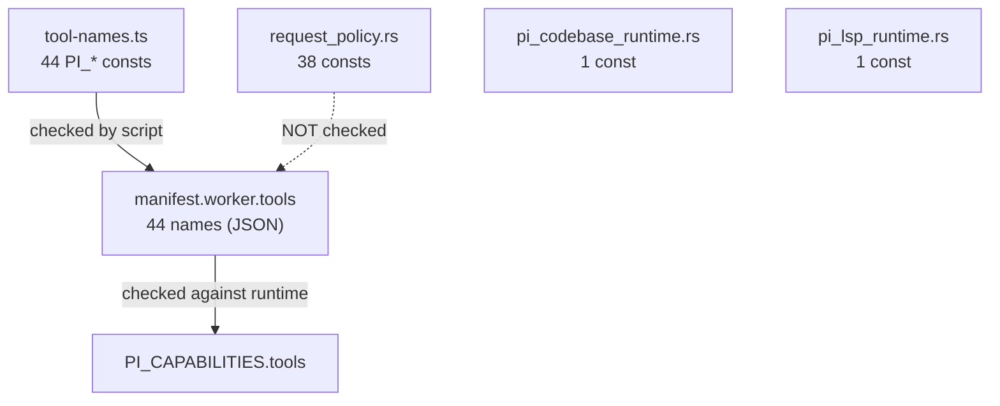

# Design — Contract Tool Name Table

## Current State

Three hand-maintained copies of the same vocabulary:



The dotted edge is the defect. Measured: renaming a Rust constant leaves
`check-pi-compatibility` green.

## Options

### A. Script-only comparison

Add a Rust↔manifest comparison to `check-pi-compatibility.mjs` without touching
production code.

- Smallest diff, zero risk.
- Three copies remain; the contract still has no vocabulary.
- The manifest stays a hand-edited truth source.
- Rejected: leaves the root cause in place.

### B. Contract table + typed worker constants + Rust validation (chosen)

Declare the vocabulary once in `@melody/agent-contract`; the worker constants
become typed derivations; a child checker validates Rust against the contract.

- One declared source of truth for both TS consumers.
- The compiler enforces the worker side (no runtime check needed).
- The Rust side needs one script rule, because Rust cannot import TS.
- Cost: a new contract file, a new checker, and mechanical edits to
  `tool-names.ts`.

### C. Generate Rust constants from the contract

Emit `request_policy.rs` from a JSON dump at build time.

- Removes the Rust copy entirely.
- Requires a build step, generated-file hygiene, and Cargo integration; the
  current repo has no codegen infrastructure.
- Deferred. B makes the same guarantee with a check instead of generation.

## Chosen Design (B)

### 1. Contract module

`packages/agent-contract/src/tool-names.ts`:

```ts
/**
 * Tools the worker advertises to the Host. The manifest, the worker gateway
 * list, and the Rust routing constants must all agree with this table.
 */
export const AGENT_TOOL_NAMES = [
  "workspace_read_file",
  ...
] as const;

/** Internal bridges the Host routes but never advertises to the model. */
export const AGENT_INTERNAL_TOOL_NAMES = [
  "workspace_create_subagent_worktree",
  "melody_internal_instruction_scope",
] as const;

/**
 * Advertised names the worker resolves itself; the Host gateway never routes
 * them, so they must stay out of `request_policy.rs`.
 */
/**
 * Advertised names the worker resolves itself; the Host gateway never routes
 * them, so they must stay out of `request_policy.rs`.
 */
export const AGENT_WORKER_OWNED_TOOL_NAMES = [
  "task",
  "get_task_output",
  "wait_tasks",
  "kill_task",
] as const satisfies readonly (typeof AGENT_TOOL_NAMES)[number][];

export type AgentToolName =
  | (typeof AGENT_TOOL_NAMES)[number]
  | (typeof AGENT_INTERNAL_TOOL_NAMES)[number];

export type AgentAdvertisedToolName = (typeof AGENT_TOOL_NAMES)[number];

export const isAgentToolName = (value: string): value is AgentToolName => ...
```

Style follows `session-modes.ts`: `const` tuple, derived union, guard.

### 2. Worker constants

`tool-names.ts` keeps its exported names (5 modules import them) but each value
is drawn from the contract:

```ts
import {
  AGENT_TOOL_NAMES,
  type AgentAdvertisedToolName,
} from "@melody/agent-contract";

/** Positional lookup is fragile; use a typed record instead. */
const ADVERTISED: Record<AgentAdvertisedToolName, AgentAdvertisedToolName> =
  Object.fromEntries(AGENT_TOOL_NAMES.map((name) => [name, name])) as ...;

export const PI_WORKSPACE_READ_FILE = ADVERTISED.workspace_read_file;
```

`Record<K, K>` makes a misspelled key a compile error and keeps the constant
type as a literal union member.

Internal constants use the same pattern with `AGENT_INTERNAL_TOOL_NAMES`.

`PI_GATEWAY_TOOL_NAMES` keeps its explicit list but is annotated
`readonly AgentAdvertisedToolName[]`, so a stray literal fails
`check:agent-worker`.

`PI_BACKGROUND_TERMINAL_TASK_PREFIX` stays a local worker constant: it is an id
prefix, not a tool name.

### 3. Rust validation

`scripts/pi-tool-names-compatibility.mjs`:

```js
export const checkPiToolNamesCompatibility = (
  { contract, requestPolicy, codebaseRuntime, lspRuntime, manifestTools },
) => failures;
```

Pure function over source strings, matching every existing child checker. The
aggregate script reads the files, imports the contract tuple, and passes
snapshots. Rules:

1. Every `AGENT_TOOL_NAMES` value must appear in `requestPolicy`, except
   `codebase_navigation` and `lsp`, which must appear in their own modules.
2. Every `AGENT_INTERNAL_TOOL_NAMES` value must appear in `requestPolicy`.
3. Every Rust constant value must belong to the contract table (no strays).
4. `AGENT_WORKER_OWNED_TOOL_NAMES` must NOT appear in `requestPolicy`
   (the Host does not route them).
5. `manifestTools` must equal `AGENT_TOOL_NAMES`.

Rule 4 is the one that catches "someone added a Host branch for a worker alias".

### 4. Wiring

In `check-pi-compatibility.mjs`, after the existing manifest↔worker comparison:

```js
const contractToolNames = await import(
  `file://${resolve(root, "packages/agent-contract/src/tool-names.ts")}`
);
failures.push(
  ...checkPiToolNamesCompatibility({
    contract: contractToolNames,
    requestPolicy,
    codebaseRuntime,
    lspRuntime,
    manifestTools: manifest.worker?.tools ?? [],
  }),
);
```

The aggregate script is already ESM; a dynamic import keeps it synchronous
elsewhere and lets the import failure surface as one readable message.

Add the file to the `check:pi-compatibility` Prettier list and to
`format`/`format:check`.

## Risks

| Risk | Mitigation |
|------|-----------|
| `Record<K, K>` built by `Object.fromEntries` loses literal types | Use an explicit object literal, or a typed `const` map; verify with `tsc` that `PI_WORKSPACE_READ_FILE` stays a literal union member |
| Contract tuple drifts from the manifest | Rule 5 fails; the manifest becomes a validated declaration |
| Rust parse regex misses a reformatted constant | Match `pub(crate) const NAME: &str = "value";` with flexible whitespace; a miss shows as a missing tool |
| Importing the contract from a script slows the gate | Measured cost is negligible (7 exports, no dependencies) |
| Someone adds a tool only to the manifest | Rules 1 and 5 both fail |

## Verification

```bash
pnpm check:agent-contract
pnpm check:agent-worker
pnpm check:pi-compatibility
pnpm check
pnpm test:unit
pnpm test:agent-worker
cargo test --manifest-path src-tauri/Cargo.toml --lib
pnpm lint
pnpm check:architecture
pnpm format:check
```

Probe both directions and record the output before finishing.
