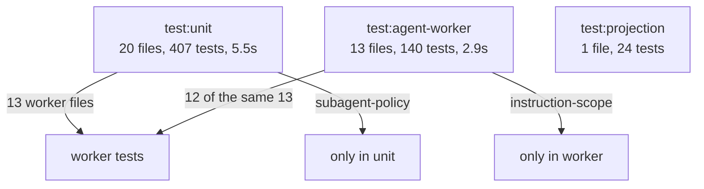
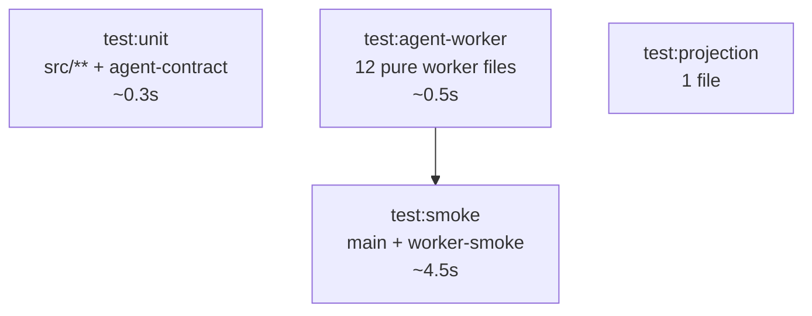

# Design — Test Suite Configuration and CI Gate

## Current Wiring



Problems: 12 files run twice; two files are in the suite that does not own
them; the three slowest tests (process spawns) block fast feedback.

## Target



Each file belongs to exactly one suite. `test:smoke` is the only slow suite and
is opt-in locally, mandatory in CI.

## Suite Definitions

### `test:unit`

```json
"test:unit": "node --experimental-strip-types --experimental-test-module-mocks --import ./scripts/test-register.mjs --test src/domain/*.test.mjs src/domain/agent/*.test.mjs src/features/files/*.test.mjs src/features/research/*.test.mjs src/stores/*.test.mjs packages/agent-contract/src/*.test.mjs"
```

Every renderer and contract test; no `packages/agent-worker` path.

### `test:agent-worker`

`packages/agent-worker/package.json`, excluding the two process-level files:

```json
"test": "node --experimental-strip-types --test src/transport.test.mjs src/idempotency.test.mjs src/pi/event-mapper.test.mjs src/pi/model-catalog.test.mjs src/pi/tool-gateway.test.mjs src/pi/todo-extension.test.mjs src/pi/goal-extension.test.mjs src/pi/compaction-extension.test.mjs src/pi/instruction-scope-extension.test.mjs src/pi/subagent-policy.test.mjs src/pi/session-adapter.test.mjs src/pi/session-import.test.mjs"
```

Note `subagent-policy` moves in, `main` and `worker-smoke` move out.

### `test:smoke`

Root `package.json`:

```json
"test:smoke": "node --experimental-strip-types --test packages/agent-worker/src/main.test.mjs packages/agent-worker/src/worker-smoke.test.mjs"
```

These spawn real processes; that is why they are separate.

## Verification Method

Do not trust the lists. Expand them and compare against disk:

```bash
node -e '...'   # script below
```

```js
import { execSync } from "node:child_process";
import { readFileSync } from "node:fs";

const unit = JSON.parse(readFileSync("package.json", "utf8")).scripts["test:unit"]
  .split(/\s+/).filter((f) => f.endsWith(".mjs"));
const worker = JSON.parse(readFileSync("packages/agent-worker/package.json", "utf8"))
  .scripts.test.split(/\s+/).filter((f) => f.endsWith(".mjs"));
const smoke = JSON.parse(readFileSync("package.json", "utf8")).scripts["test:smoke"]
  .split(/\s+/).filter((f) => f.endsWith(".mjs"));

const all = execSync('find packages/agent-worker/src -name "*.test.mjs"', { encoding: "utf8" })
  .trim().split("\n").map((f) => f.replace("packages/agent-worker/src/", ""));

const workerSet = new Set(worker.map((f) => f.replace("src/", "")));
const smokeSet = new Set(smoke.map((f) => f.replace("packages/agent-worker/src/", "")));

// every worker file in exactly one of worker|smoke
for (const file of all) {
  const inWorker = workerSet.has(file);
  const inSmoke = smokeSet.has(file);
  if (inWorker !== inSmoke) continue;
  console.log("BAD", file, { inWorker, inSmoke });
}
```

Assert: no `agent-worker` path in `test:unit`; every worker file in exactly one
of `test:agent-worker` / `test:smoke`.

## CI Change

Insert after `pnpm check` and before `pnpm build`:

```yaml
      - run: pnpm test:unit
      - run: pnpm test:agent-worker
      - run: pnpm test:projection
      - run: pnpm test:smoke
      - run: cargo test --manifest-path src-tauri/Cargo.toml --lib
```

Rationale for placement:

- After `pnpm check`: a type error is cheaper to read than a test failure.
- Before `pnpm build`: `build` is the slowest step; failing tests should
  short-circuit it.
- `cargo test` last among tests: it shares the Rust cache with `cargo fmt`.

## Risks

| Risk | Mitigation |
|------|-----------|
| A file silently stops running | The expansion check above; run it before and after |
| `test:smoke` becomes the forgotten suite | It is a CI step, so a break fails the PR |
| CI time grows | Measured locally: unit ~0.3s, worker ~0.5s, smoke ~4.5s, cargo ~2s; the Rust build dominates anyway |
| Worker package `test` changes behavior for `pnpm --filter` users | It still runs the full pure set; only the two spawn tests move to the root script |
| Node 22 in CI lacks a flag used locally | Node 24-only flag check: `--experimental-test-module-mocks` exists in Node 22.15+; verify by reading `package.json` engines (`>=22 <25`) and running CI, or pin the step to the tested Node version |

The last row is the one real unknown: the local run used Node 24.14.1. CI uses
Node 22. If `--experimental-test-module-mocks` is unavailable there, the store
tests fail to mock. Check this during implementation and record the outcome;
if unsupported, the store suite needs a Node-version guard rather than a
silent skip.

## Verification

```bash
pnpm test:unit
pnpm test:agent-worker
pnpm test:projection
pnpm test:smoke
cargo test --manifest-path src-tauri/Cargo.toml --lib
pnpm check
pnpm lint
pnpm check:architecture
pnpm format:check
```

Plus the expansion check and a diff proving no test file changed.
