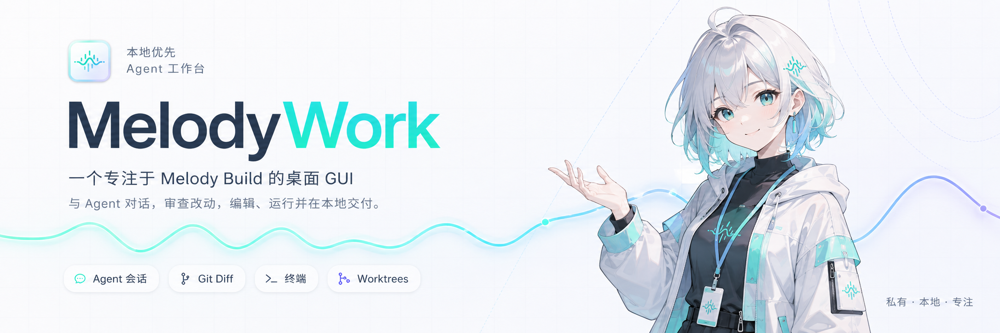
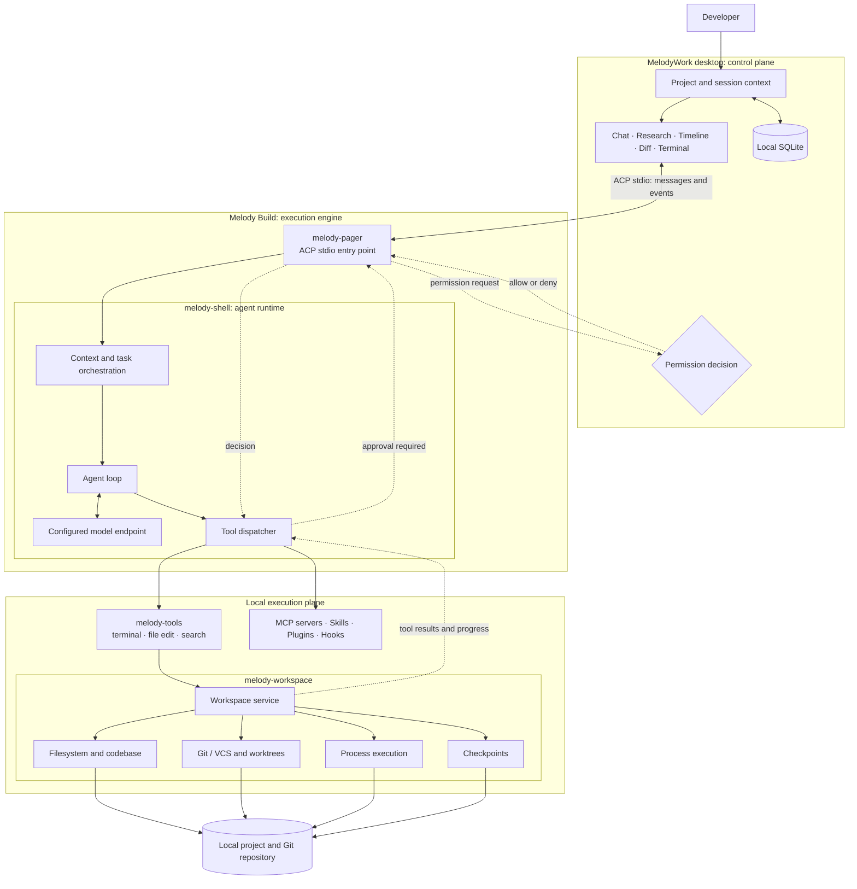

**English** | [简体中文](README.zh-CN.md)

# MelodyWork

> A local-first desktop workspace for building with [Melody Build](https://github.com/Lhy723/melody-build).

Talk through a task, inspect the result, review the diff, and ship directly from the project already on your machine. MelodyWork keeps the agent loop grounded in the repository, with visible tool activity and explicit permission boundaries.

Pi is MelodyWork's only Agent runtime for desktop sessions. Existing ACP sessions remain read-only archives; capabilities Pi cannot safely provide are reported as unavailable, while unsafe session configurations block opening Pi. There is no ACP runtime fallback. The bundled Pi worker uses the product protocol and Host-owned policy boundary for files, terminal, MCP/Web, memory, LSP, bounded tree-sitter codebase navigation, subagents, and background tasks.

[Development guide](docs/development.md) · [Release guide](docs/releasing.md)

`Local-first` `Git-native` `macOS` `Windows`

## Built for the Whole Loop

| Plan & Research                                                                                                   | Build & Review                                                                                                  | Control & Ship                                                                                                     |
| ----------------------------------------------------------------------------------------------------------------- | --------------------------------------------------------------------------------------------------------------- | ------------------------------------------------------------------------------------------------------------------ |
| Start and resume Pi Agent sessions, collect research context, and keep source material beside the implementation. | Inspect files and per-file Git diffs, edit within workspace boundaries, and work through a deliberate terminal. | Stage and commit changes, manage branches and worktrees, and decide permissions once, per session, or per project. |

## How the Agent Engine Works

The diagram below preserves the former Legacy ACP architecture for migration context; it is not an available Agent runtime. Current sessions run the model/session loop in the bundled Pi worker behind the same desktop control plane and Host execution boundary; the migration design and capability matrix live in [`docs/architecture/pi-migration`](docs/architecture/pi-migration/README.md).



Solid arrows represent the execution path. Dashed arrows show events, tool results, and permission decisions flowing back to the desktop surface.

### One turn, end to end

1. You describe an outcome in MelodyWork and choose the project or worktree where it belongs.
2. MelodyWork starts or resumes the bundled Pi worker. An existing ACP session stays archived until the user explicitly imports it through the migration flow.
3. The selected agent runtime reads the workspace, reasons about the task, and selects the tools it needs.
4. Host-owned tools perform terminal, file, search, codebase navigation, and workspace operations. Permission-sensitive actions can pause for your decision.
5. Tool output and progress stream through the product event protocol, so the timeline stays inspectable while the agent works.
6. The resulting files remain in the local workspace. MelodyWork then gives you the Git diff, branch, worktree, and commit controls needed to review and deliver them.

This separation is intentional: Pi owns the model/session loop, while MelodyWork owns the desktop experience, session navigation, project boundaries, review surfaces, Host tools, and user decisions. Missing peripheral capabilities are surfaced as diagnostics; safety-critical gaps stop session opening instead of switching execution engines.

## Why This Shape

- **Local-first:** projects, session state, files, Git history, tool activity, and project rules stay on the machine where the work happens.
- **Protocol-driven:** the versioned product protocol gives the desktop client a clear boundary around messages, tool calls, progress, and permissions.
- **Inspectable by default:** the agent can move quickly, but changes remain visible through timelines, file previews, diffs, and Git actions.
- **Consistent execution boundary:** the Pi worker and Host share the product contract; MelodyWork keeps permissions and workspace policy consistent across the desktop experience.

The current beta has no account system or cloud sync.

## Getting Started

MelodyWork is currently built from source. You will need Node.js 22, pnpm, Rust, [DotSlash](https://dotslash-cli.com), ripgrep, and the Tauri 2 system dependencies for your platform.

Melody Build is pinned as the `vendor/melody-build` Git submodule. On a fresh clone:

```bash
git submodule update --init --recursive
pnpm install
cargo install dotslash --locked
pnpm tauri dev
```

See the [development guide](docs/development.md) for validation commands and sidecar behavior.

## Documentation

- [Development guide](docs/development.md): prerequisites, commands, and sidecar resolution
- [Release guide](docs/releasing.md): tags, updater signing, and platform release notes

## Contributing

Contributions are welcome. Before opening a pull request:

1. Keep the change focused and explain the user-facing behavior it changes.
2. Run `pnpm check`, `pnpm test:unit`, `pnpm build`, and `cargo test --manifest-path src-tauri/Cargo.toml` when the change touches the relevant surface.
3. Include or update tests and documentation when behavior or public workflows change.
4. Do not commit generated sidecars, build output, credentials, or updater private keys.

For bugs, include the operating system, reproduction steps, expected behavior, and relevant logs. For larger changes, open an issue first so the implementation can stay aligned with the project direction.

## License

MelodyWork is released under the [MIT License](./LICENSE).
