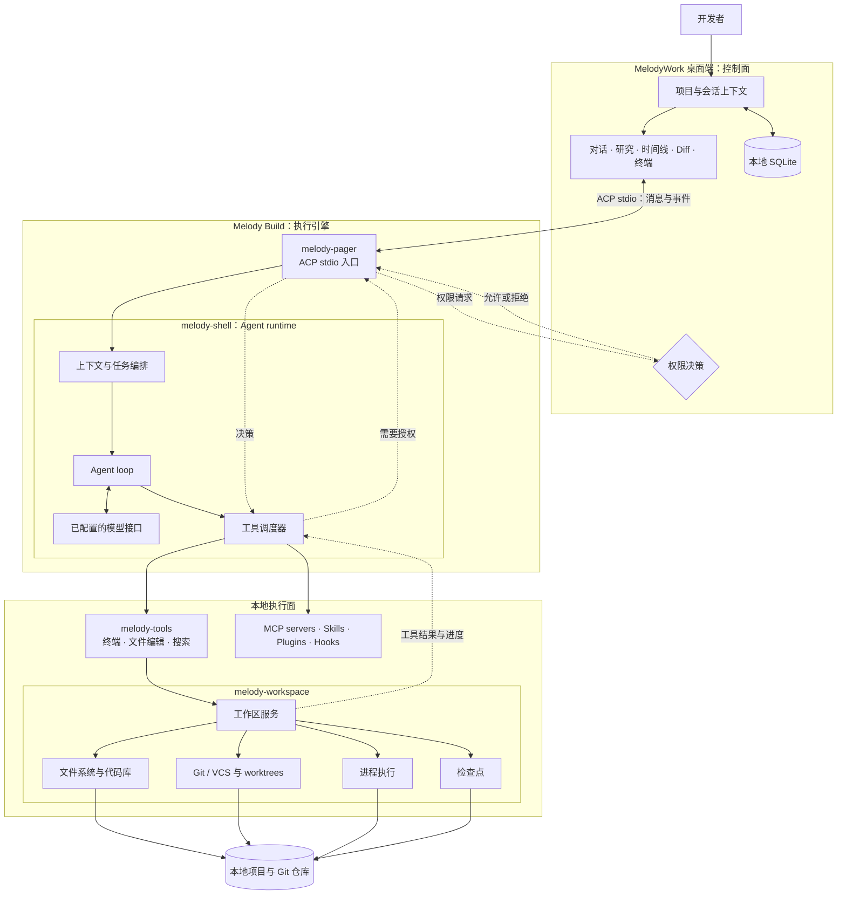

[English](README.md) | **简体中文**

# MelodyWork

> 一个面向 [Melody Build](https://github.com/Lhy723/melody-build) 的本地优先桌面工作台。

围绕任务与 Agent 对话，查看结果，审查 Diff，并直接在本地项目中交付。MelodyWork 让 Agent 工作闭环始终扎根于仓库：工具活动可见，权限边界明确，开发者始终保有控制权。

桌面 Agent 会话只使用 Pi runtime。已有 ACP 会话保留为只读归档；Pi 暂时无法安全提供的能力会明确报告为不可用，涉及安全边界的配置会阻止打开 Pi，不会运行时回退到 ACP。随应用打包的 Pi worker 通过产品协议和 Host 策略边界提供文件、终端、MCP/Web、记忆、LSP、受限 tree-sitter 代码库导航、子代理和后台任务。

[开发指南](docs/development.md) · [发布指南](docs/releasing.md)

`本地优先` `Git 原生` `macOS` `Windows`

## 覆盖完整工作闭环

| 规划与研究                                                               | 构建与审查                                                                    | 控制与交付                                                              |
| ------------------------------------------------------------------------ | ----------------------------------------------------------------------------- | ----------------------------------------------------------------------- |
| 启动和恢复 Pi Agent 会话，收集研究上下文，并将来源材料保留在实现工作旁。 | 查看文件和逐文件 Git Diff，在工作区边界内编辑，通过集成终端有意识地执行命令。 | 暂存和提交变更，管理分支与 worktree，并按一次、会话或项目范围决定权限。 |

## Agent 引擎的工作方式

下面的图保留了迁移前的 Legacy ACP 架构，仅作历史参考，不是当前可用的 Agent runtime。现在的会话都由随应用打包的 Pi worker 执行模型/会话循环，并使用同一套桌面控制面和 Host 执行边界；迁移设计和能力矩阵见 [`docs/architecture/pi-migration`](docs/architecture/pi-migration/README.md)。



实线表示执行路径；虚线表示事件、工具结果和权限决策如何返回桌面端。

### 一个任务如何完成

1. 你在 MelodyWork 中描述目标，并选择任务所属的项目或 worktree。
2. MelodyWork 启动或恢复随应用打包的 Pi worker。已有 ACP 会话保持归档，只有用户通过迁移流程显式导入后才会建立 Pi 会话。
3. 所选 Agent runtime 读取工作区，分析任务，并选择需要使用的工具。
4. Host-owned 工具执行终端、文件、搜索、代码库导航和工作区操作；涉及权限的动作可以暂停并等待你的决定。
5. 工具输出和进度通过产品事件协议流回 MelodyWork，时间线会持续展示整个执行过程。
6. 结果文件仍然留在本地工作区。MelodyWork 再提供 Git Diff、分支、worktree 和提交控制，让你审查并交付改动。

这种分层是有意设计的：Pi 负责模型/会话循环，MelodyWork 负责桌面体验、会话导航、项目边界、审查界面、Host 工具和用户决策。缺失的外围能力会通过诊断明确说明；安全关键能力缺失时会停止打开会话，不会切换执行引擎。

## 为什么这样设计

- **本地优先：** 项目、会话状态、文件、Git 历史、工具活动和项目规则都保留在实际工作的本机上。
- **协议驱动：** 版本化产品协议为消息、工具调用、进度和权限建立清晰边界。
- **默认可审查：** Agent 可以快速工作，但所有改动都能通过时间线、文件预览、Diff 和 Git 操作查看。
- **执行边界一致：** Pi worker 与 Host 共享产品契约；MelodyWork 在桌面工作流中统一维护权限和工作区策略。

当前 beta 没有账号系统或云同步。

## Getting Started

MelodyWork 当前需要从源码构建。你需要准备 Node.js 22、pnpm、Rust、[DotSlash](https://dotslash-cli.com)、ripgrep，以及对应平台的 Tauri 2 系统依赖。

Melody Build 通过 `vendor/melody-build` Git submodule 固定。首次克隆后执行：

```bash
git submodule update --init --recursive
pnpm install
cargo install dotslash --locked
pnpm tauri dev
```

验证命令和 sidecar 行为请参阅[开发指南](docs/development.md)。

## 文档

- [开发指南](docs/development.md)：环境要求、常用命令和 sidecar 查找顺序
- [发布指南](docs/releasing.md)：标签发布、updater 签名和平台发布说明

## Contributing

欢迎参与贡献。提交 Pull Request 前请：

1. 保持改动聚焦，并说明它改变了什么用户行为。
2. 当改动涉及对应模块时，运行 `pnpm check`、`pnpm test:unit`、`pnpm build` 和 `cargo test --manifest-path src-tauri/Cargo.toml`。
3. 当行为或公开工作流发生变化时，同步补充测试和文档。
4. 不要提交生成的 sidecar、构建产物、凭据或 updater 私钥。

提交问题时，请附上操作系统、复现步骤、预期行为和相关日志。较大的改动建议先创建 issue，以便实现方向与项目规划保持一致。

## License

MelodyWork 以 [MIT 许可证](./LICENSE) 发布。
